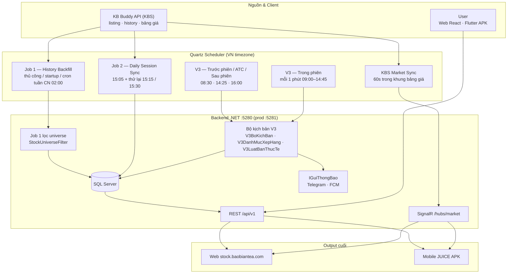
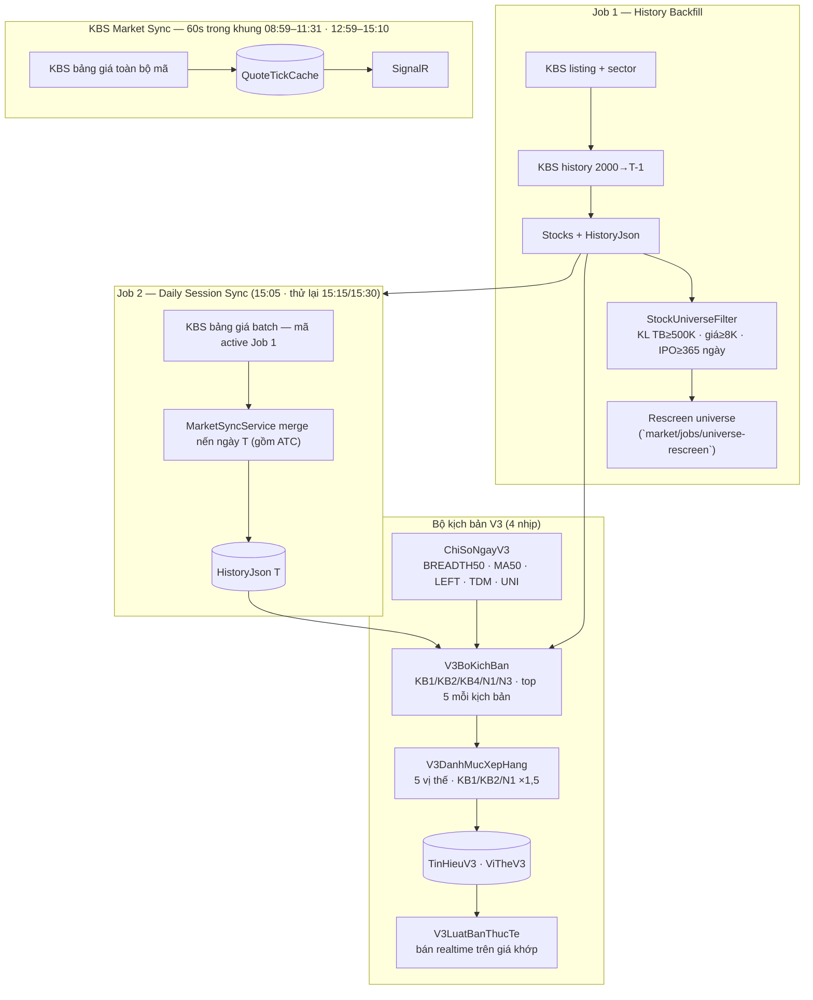
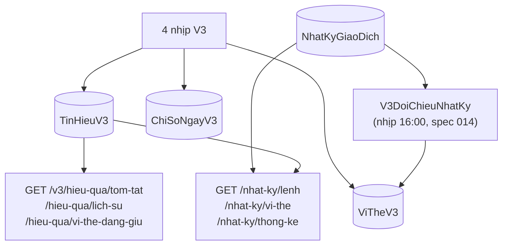
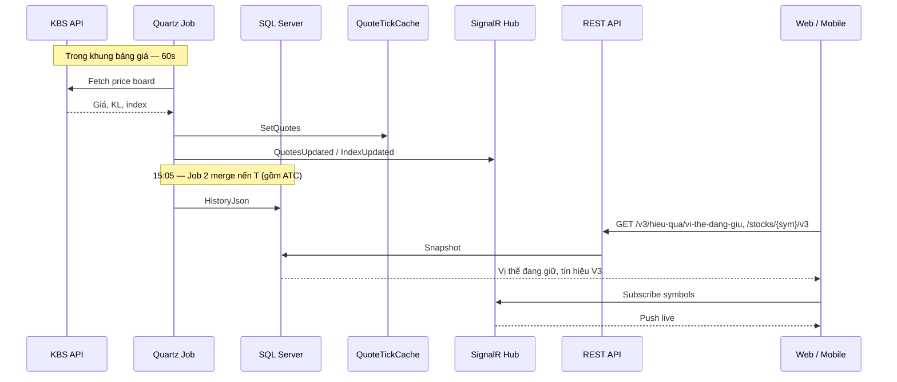

# StockRadar (JUICE) — Kiến trúc hệ thống toàn diện

> **Mục đích:** Bản đồ as-is của hệ sau khi gỡ V1 — từ Job 1 đến mọi output (giá live, bộ kịch bản V3, nhật ký, UI).  
> **Nguồn sự thật:** code trên disk (`backend/StockRadar.*`, `frontend/`, `mobile/`).  
> **Cập nhật:** 2026-11-12 (spec 016 — gỡ toàn bộ V1: Top, chấm điểm, ML/HPO, radar, theo dõi lô lớn; tombstone `domain/*`). Trước đó 2026-10-26 (spec 012 — V3 thay V2).

---

## 1. Bản đồ một trang



V1 (phân tích Top, Buy Score, xếp hạng ML/HPO, radar trong phiên, theo dõi lô lớn, cảnh báo Darvas) đã gỡ toàn bộ theo spec 016. Cách V1 làm: [`features/v1-archive/`](./features/v1-archive/README.md).

**Monorepo:** `backend/` (.NET 10 API) · `frontend/` (Vite React) · `mobile/` (Flutter) · `scripts/` (deploy).

**Production:** API `http://103.226.248.6/api/v1` · Web `https://stock.baobiantea.com/` · Deploy `.\scripts\ship-all.ps1`.

---

## 2. Timeline phiên giao dịch (chu kỳ T → T+1)

```mermaid
gantt
    title Chu kỳ dữ liệu điển hình (ngày giao dịch T)
    dateFormat HH:mm
    axisFormat %H:%M

    section T (hôm nay)
    V3 trước phiên          :08:30, 10m
    KBS sync 60s            :08:59, 6h
    V3 trong phiên (1 phút) :09:00, 6h
    V3 ATC                  :14:25, 10m
    Job 2 append nến T      :15:05, 10m
    Job 2 thử lại           :15:15, 20m
    V3 sau phiên            :16:00, 30m
```



### Ví dụ cụ thể

| Thời điểm | Việc xảy ra | Output |
|-----------|-------------|--------|
| **T-1 đêm** | Job 1 xong (hoặc rescreen) | `Stocks.HistoryJson` đến hết T-1, universe active |
| **T 08:30** | V3 trước phiên | `TinHieuV3` KB1/KB2 + `ViTheV3` CHỜ MUA, tin mua ATO |
| **T 08:59–15:10** | KBS sync 60s (khung bảng giá) | `QuoteTickCache`, SignalR `QuotesUpdated` / `IndexUpdated` |
| **T 09:00–14:45** | V3 trong phiên mỗi 1 phút | Khớp ATO, bán realtime theo `NguongChamMa` đã lưu + tin bán |
| **T 14:25** | V3 ATC | KB4/N1/N3, mua ATC, bán hết hạn, cộng điểm chỉ số hôm nay |
| **T 15:05** | Job 2 | Nến ngày T (gồm ATC) merge vào `HistoryJson`; 15:15/15:30 chỉ lấy mã còn thiếu nến |
| **T 16:00** | V3 sau phiên | `ChiSoNgayV3` + `UNI` phiên sau; `NguongChamMa`/`GiaThamChieu`/`Exchange` của vị thế |
| **T+1 sáng** | Home mobile/web | Thẻ "Đang giữ" (vị thế V3) + VNINDEX + sparkline |

---

## 3. Pipeline Job — chi tiết từng bước



### Bảng Job Quartz

| Job ID | Runner | Lịch (nguồn) | Input | Output chính |
|--------|--------|--------------|-------|--------------|
| `history-backfill` | `HistoryBackfillJob` | Thủ công / `RunOnStartup` / cron tuần **CN 02:00** (`QuartzSchedulingExtensions.cs` · `MarketJobs:History:WeeklyRefresh*`) | KBS listing, history | `Stocks`, `HistoryJson`, universe |
| `daily-session-sync` | `DailySessionSyncJob` | **15:05** T2–T6 + thử lại **15:15/15:30** (`DailySessionSyncJob` · `AfterCloseDelayMinutes` / `Retry*DelayMinutes` · `MarketJobs:DailySession:Hour/Minute`) | KBS bảng giá mã active | Nến ngày T (gồm ATC) trong `HistoryJson` |
| `kbs-market-sync` | `KbsMarketSyncJob` | **60s**, chỉ trong `IsInQuoteSyncWindow` 08:59–11:31 · 12:59–15:10 ngày giao dịch (`VietnamMarketCalendar.cs` · `MarketData:SyncIntervalSeconds`) | KBS bảng giá toàn bộ mã | `QuoteTickCache`, SignalR `QuotesUpdated`/`IndexUpdated` |
| `v3-truoc-phien` | `V3TruocPhienRunner` | **08:30** T2–T6 (`ConfigureV3Jobs`) | ~200 mã `UNI` đã lưu + chuỗi `ChiSoNgayV3` | `TinHieuV3` + `ViTheV3` CHỜ MUA, tin mua ATO |
| `v3-trong-phien` | `V3TrongPhienRunner` | **mỗi 1 phút** 09:00–14:45 (`V3:IntervalPhut`) | Quote mã đang giữ (không nạp lịch sử) | Khớp ATO + `ViTheV3` thoát theo `NguongChamMa` đã lưu, tin bán |
| `v3-atc` | `V3AtcRunner` | **14:25** T2–T6 | `UNI` đã lưu + mã đang giữ; quote + KL khớp tích luỹ | `TinHieuV3` KB4/N1/N3 · mua ATC · bán hết hạn · cộng điểm chỉ số hôm nay |
| `v3-sau-phien` | `V3SauPhienRunner` | **16:00** T2–T6 | `LayCacMaAsync` toàn universe (nhịp nạp đầy đủ duy nhất) | `ChiSoNgayV3` (chỉ số + `UNI` phiên sau) · `ViTheV3`: `NguongChamMa`/`GiaThamChieu`/`Exchange` |
| `v3-nap-chi-so` (chạy tay khi deploy) | `V3NapChiSoBackfillRunner` | một lần (`V3:TuNgayNapChiSo`, mặc định 01/2023) | toàn universe + `TinhChuoi` | chuỗi `ChiSoNgayV3` + `UNI` từng ngày; **không** tín hiệu/vị thế |

### API trigger (header `X-Sync-Key`)

| Endpoint | Tương đương |
|----------|-------------|
| `POST /api/v1/market/jobs/history` · `/history/night` | Job 1 (ngày · đêm) |
| `POST /api/v1/market/jobs/session` | Job 2 |
| `POST /api/v1/market/jobs/universe-rescreen` | Rescreen universe (chỉ DB) |
| `POST /api/v1/market/jobs/kbs-sync` | 1 vòng KBS sync (vẫn qua khung bảng giá) |
| `POST /api/v1/market/jobs/v3-truoc-phien` · `v3-trong-phien` · `v3-atc` · `v3-sau-phien` · `v3-nap-chi-so` | 4 nhịp V3 + nạp chuỗi chỉ số |
| `GET /api/v1/market/jobs` · `/history/status` | Trạng thái job gần nhất |

> Endpoint V1 đã gỡ: `market/jobs/analysis`, `market/jobs/daily`, `market/jobs/intraday-scan`, `market/jobs/opportunity-monitor`, `opportunities*`, `radar-items*`, `market/trades`, `market/flow/*`, `ml/*`, `criteria/*`, `performance/*`, `backtest/smartmoney`.

---

## 4. Còn lại sau khi gỡ V1

Luật chấm điểm mua của V1 (Buy Score 8 tiêu chí, 4 cổng Top, flatBox/Darvas, MA stack + pha, ML ranker, HPO) **không còn** trong code. Doc cũ giữ làm lịch sử thiết kế:

- [`domain/buy-decision.md`](./domain/buy-decision.md)
- [`domain/base-price-flatbox.md`](./domain/base-price-flatbox.md)
- [`domain/ma-stack-and-market-phase.md`](./domain/ma-stack-and-market-phase.md)
- Cách V1 làm: [`features/v1-archive/`](./features/v1-archive/README.md)

Thành phần Domain còn sống:

| Thành phần | Vai trò | Ghi chú |
|------------|---------|---------|
| `StockUniverseFilter` + `IndicatorMath` | Lọc universe ở Job 1 | `IndicatorMath.AverageVolume` là nguồn duy nhất cho KL TB 20 phiên |
| `V3BoKichBan` · `V3DanhMucXepHang` · `V3LuatBanThucTe` | Sinh tín hiệu · xếp vị thế · luật bán | Canon: [`domain/pipeline-jobs.md`](./domain/pipeline-jobs.md) |
| `VietnamMarketCalendar` | Ngày giao dịch + khung bảng giá | `IsInQuoteSyncWindow` |
| `BoDieuChinhGiaTheoQuyen` | Điều chỉnh giá theo quyền | Đã đăng ký DI, chưa nơi nào gọi — spec 015 sẽ dùng |

Tài liệu canon của V3: [`domain/pipeline-jobs.md`](./domain/pipeline-jobs.md) · [`features/v3-scenario-engine/research/`](./features/v3-scenario-engine/research/).

---

## 5. Kênh thông báo

| Kênh | Nội dung | Nguồn |
|------|----------|-------|
| Telegram (`IGuiThongBao` · `TelegramNotify`) | Tin mua (ATO/ATC) và tin bán của V3 | 4 runner V3 |
| FCM (`Push`) | Push mobile, đăng ký qua `thiet-bi/dang-ky` / `thiet-bi/go` | `IGuiThongBao` |
| SignalR `/hubs/market` | `QuotesUpdated` · `IndexUpdated` | `KbsMarketSyncJob` |

V1 Master Alerts, Entry Ready, VIP publisher và radar `SessionRadarHits` đã gỡ (spec 011 + 016). Hằng số `Domain/MasterAlerts` vẫn còn vì `NhatKyService` dùng cho nhãn lệnh.

---

## 6. Đo hiệu quả (V3) & Nhật ký



- `ViTheV3` chỉ ghi đè theo lệnh thật khi đặt `V3:TaiKhoanDanhMuc` (spec 014). Khoá này để trống trong repo.
- Nhật ký: người dùng ghi lệnh khớp thật, gắn `TinHieuV3Id`; nhịp 16:00 đối chiếu rồi mới đưa mã ra khỏi "Đang giữ".
- Bỏ qua tín hiệu: `PUT/DELETE /nhat-ky/tin-hieu/{nguon}/{maTinHieu}/bo-qua` ghi `NhatKyTinHieuBoQua`.

North Star, ML ranker, criterion scoring và HPO tuần đã gỡ cùng V1 (spec 016).

---

## 7. Realtime & luồng client



### Output theo màn hình

Mobile bottom nav **4 tab**: **Trang chủ · Watchlist · Hiệu quả · Nhật ký** (+ màn push: Chi tiết mã, Sự kiện quyền). Web: `/`, `/watchlist`, `/performance`, `/stock/:symbol`, `/rights-events`, `/login`.

| Màn hình | API / nguồn | Hiển thị chính |
|----------|-------------|----------------|
| **Trang chủ** | `GET /v3/hieu-qua/vi-the-dang-giu` · `GET /market/vnindex/chart` · `GET /market/sparklines` | Danh sách "Đang giữ" (giá mua, giá hiện tại, % lãi lỗ, giá chốt lời, số phiên còn lại) + sparkline; thẻ VNINDEX (giá + biểu đồ) |
| **Watchlist** | `GET /watchlists` · `/watchlists/{id}/items` · `GET /stocks/{sym}/v3` | Nhiều watchlist/user; mã có tín hiệu hoặc vị thế V3 hiện huy hiệu V3 |
| **Hiệu quả** | `GET /v3/hieu-qua/tom-tat` · `/lich-su` | Tổng quan + lịch sử vị thế V3 |
| **Nhật ký** | `GET /nhat-ky/lenh` · `/vi-the` · `/thong-ke` · `/tin-hieu/v3` | Ghi/sửa lệnh khớp thật gắn tín hiệu V3 |
| **Chi tiết CP** | `GET /stocks/{sym}` · `/chart` · `/v3` · `/rights-events` | Giá, biểu đồ ngày, tín hiệu/vị thế V3, sự kiện quyền, dòng "mã ngoài universe" |
| **Sự kiện quyền** | `GET /stocks/{sym}/rights-events` · `POST` | Lịch sự kiện quyền của mã |

**Mobile:** `mobile/lib/core/api/api_client.dart` · **Web:** `frontend/src/lib/api.ts` · Default API prod trong `api_config.dart`.

---

## 8. Lớp dữ liệu (SQL chính)

Mô hình hiện tại có **13 bảng** (`ApplicationDbContextModelSnapshot.cs`):

| Bảng / Entity | Ghi bởi | Đọc bởi |
|---------------|---------|---------|
| `Stocks` (`HistoryJson`, sector, giá, universe) | Job 1, Job 2, rescreen | Mọi engine, stock API |
| `MarketIndices` | Job 1, Job 2 | VNINDEX chart, `ChiSoNgayV3` |
| `SectorDefinitions` | Job 1 | Danh mục ngành |
| `TinHieuV3` | 4 runner V3 | `GET /stocks/{sym}/v3`, `/v3/hieu-qua/*`, `/nhat-ky/tin-hieu/v3` |
| `ViTheV3` | V3 trong phiên / ATC / sau phiên / đối chiếu Nhật ký | Màn Hiệu quả, Home "Đang giữ" |
| `ChiSoNgayV3` | V3 trước phiên / ATC / sau phiên | Nền chỉ báo cho 5 kịch bản |
| `NhatKyGiaoDich` | `nhat-ky/lenh` | Nhật ký, `V3DoiChieuNhatKy` |
| `NhatKyTinHieuBoQua` | `nhat-ky/tin-hieu/.../bo-qua` | Lọc tín hiệu V3 |
| `Watchlists` / `WatchlistItems` | Watchlists API | Màn Watchlist |
| `Users` | `auth/tokens`, `users` | Đăng nhập |
| `ThietBiNhanThongBao` | `thiet-bi/*` | Push FCM |
| `JobRunStatuses` | `JobStatusService` (Job 1, V3) | `GET /market/jobs`, `/history/status` |

> `KetQuaKichBan` (V2) còn trên DB nhưng không còn trong model — đã ngừng ghi từ spec 012.
> 26 bảng V1 đã xoá bằng migration `20261112064612_RemoveV1Tables` (12/11/2026), dữ liệu xuất ra `v1-export-20261112.tar.gz`.

---

## 9. Config production quan trọng

### `V3` (top-level — spec 012)

| Key | Mặc định repo | Ý nghĩa |
|-----|---------------|---------|
| `V3:Enabled` | true | Bật/tắt cả 4 nhịp Quartz |
| `V3:IntervalPhut` | 1 | Nhịp khớp ATO + xét bán realtime (09:00–14:45) |
| `V3:GioBatDau` / `GioKetThuc` | 09:00 / 14:45 | Khung nhịp trong phiên |
| `V3:Kb1*` / `Kb2*` / `Kb4*` / `N1*` / `N3*` | xem `appsettings.json` | Ngưỡng điều kiện của từng kịch bản |
| `V3:BanPhanTramGiaVao` | 1,004 | Sàn lãi tối thiểu khi bán realtime |
| `V3:GiuToiDa*` | 15/15/10/15/12 | Số phiên giữ tối đa KB1/KB2/KB4/N1/N3 |
| `V3:MaxViThe` · `SoChiaViThe` · `TrongSoNhan` | 5 · 5 · 1,5 | Danh mục: slot, cỡ lệnh V/5, hệ số KB1/KB2/N1 |
| `V3:PhiKhuriHoi` · `NguongThang` | 0,004 · 0,0005 | Phí khứ hồi · ngưỡng Thắng/Thua/Hoà vốn |
| `V3:TaiKhoanDanhMuc` | `""` | Đặt trên server để `ViTheV3` chạy theo lệnh thật (spec 014) |

### `MarketJobs` / `MarketData`

| Key | Mặc định repo | Ý nghĩa |
|-----|---------------|---------|
| `MarketJobs:History:WeeklyRefreshDay/Hour/Minute` | Sunday · 2 · 0 | Cron refresh universe hằng tuần |
| `MarketJobs:History:RunOnStartup` | false | Chạy Job 1 khi API khởi động |
| `MarketJobs:DailySession:Hour/Minute` | 15 · 0 | Mốc Job 2 (trigger = mốc + `AfterCloseDelayMinutes`, xem `pipeline-jobs.md`) |
| `MarketJobs:DailySession:BatchSize` | 40 | Số mã mỗi lượt gọi KBS |
| `MarketData:SyncIntervalSeconds` | 60 | Nhịp KBS sync (tối thiểu 30) |
| `MarketData:AutoSyncEnabled` | true | Bật job KBS sync |

> Giá trị trên là **mặc định trong repo**. `appsettings.Production.json` trên server là file riêng, có thể khác.

### Bảo mật: quyền kích job & mật khẩu admin

- **Quyền kích pipeline job** (`POST /api/v1/market/jobs/*`, logic trong `JobTriggerAuthorization.IsAllowed`): chỉ (a) user **đã đăng nhập là admin** (`AdminUser.Id`) hoặc (b) header `X-Sync-Key` **khớp** `MarketData:SyncApiKey` (khác rỗng). Controller không dùng `[Authorize]` vì script trong `scripts/` gọi bằng `X-Sync-Key`, không có JWT.
- **`Admin:Password`** (đặt trong cấu hình server, không để giá trị thật trong repo): khi khác rỗng, API tạo mới hoặc **đặt lại** mật khẩu admin theo giá trị này mỗi lần khởi động; để trống thì không tạo/đổi admin và ghi một dòng log cảnh báo.

---

## 10. Sơ đồ end-to-end (tất cả output)

```mermaid
flowchart TB
    KBS[(KB Buddy)]

    KBS --> J1[Job 1 Universe + History]
    J1 --> DB[(Database)]

    KBS --> J2[Job 2 Session T — 15:05]
    J2 --> DB

    KBS --> SYNC[KBS Sync 60s]
    SYNC --> LIVE[SignalR Quotes / Index]

    DB --> V3[4 nhịp V3]
    V3 --> TIN[Tín hiệu + vị thế]
    V3 --> TG[Telegram mua/bán]
    V3 --> FCM[Push mobile]

    TIN --> UI[Home "Đang giữ" · Hiệu quả · Chi tiết mã]
    TIN --> NK[Nhật ký đối chiếu 16:00]
    NK --> TIN
```

---

## 11. File entry & tài liệu chuyên sâu

| Chủ đề | File code | Doc |
|--------|-----------|-----|
| Mục lục docs | — | [`README.md`](./README.md) |
| Quartz / jobs | `QuartzSchedulingExtensions.cs`, `Scheduling/Jobs/*` | [`domain/pipeline-jobs.md`](./domain/pipeline-jobs.md) |
| Bộ kịch bản V3 (spec 012) | `V3BoKichBan.cs`, `V3TruocPhienRunner.cs`, `V3TrongPhienRunner.cs`, `V3AtcRunner.cs`, `V3SauPhienRunner.cs` | **Canon luồng:** [`domain/pipeline-jobs.md`](./domain/pipeline-jobs.md) · luật: [`features/v3-scenario-engine/research/`](./features/v3-scenario-engine/research/) (spec: [`specs/012-v3-scenario-engine/spec.md`](../specs/012-v3-scenario-engine/spec.md)) |
| Danh mục thật (spec 014) | `V3DanhMucXepHang`, `V3DoiChieuNhatKy` | [`specs/014-v3-real-portfolio/spec.md`](../specs/014-v3-real-portfolio/spec.md) |
| Lọc universe | `StockUniverseFilter.cs`, `IndicatorMath.cs` | [`domain/pipeline-jobs.md`](./domain/pipeline-jobs.md) |
| Watchlist | `WatchlistsController.cs`, `WatchlistService.cs` | [`use_cases/UC-005-manage-watchlist.md`](./use_cases/UC-005-manage-watchlist.md) |
| Nhật ký giao dịch | `NhatKyController.cs`, `NhatKyService` | [`specs/010-trade-journal/spec.md`](../specs/010-trade-journal/spec.md) |
| Điều chỉnh giá theo quyền | `BoDieuChinhGiaTheoQuyen` | [`specs/006-paid-rights-adjust/spec.md`](../specs/006-paid-rights-adjust/spec.md) |
| Deploy | `scripts/ship-all.ps1` | [`build-and-deploy.md`](./build-and-deploy.md) |
| V1 (đã gỡ) | — | [`domain/buy-decision.md`](./domain/buy-decision.md) · [`features/v1-archive/`](./features/v1-archive/README.md) |
| Luồng cũ (tham chiếu) | — | [`_archive/project-data-flow.md`](./_archive/project-data-flow.md) |

---

## 12. Checklist review trước production

- [ ] Job 1 đã chạy xong — universe active, `Stocks.updatedAt` gần đây
- [ ] Job 2 chạy 15:05 và nến ngày T có trong `HistoryJson` (thử lại 15:15/15:30 nếu thiếu)
- [ ] `kbs-market-sync` chỉ log trong khung 08:59–11:31 · 12:59–15:10, không có trigger `-interval`
- [ ] V3: `v3-truoc-phien` 08:30 + `v3-trong-phien` mỗi phút + `v3-atc` 14:25 + `v3-sau-phien` 16:00 chạy, ghi `TinHieuV3` / `ViTheV3` / `ChiSoNgayV3`
- [ ] `V3:TaiKhoanDanhMuc` đã đặt nếu muốn danh mục chạy theo lệnh thật
- [ ] Migration mới đã apply trên prod DB (lần gần nhất: `20261112064612_RemoveV1Tables`)
- [ ] `TelegramNotify:Enabled` + token; `Push:Enabled` nếu bật FCM
- [ ] Ship: `.\scripts\ship-all.ps1 -Message "..."` → verify `GET /api/v1/v3/hieu-qua/tom-tat`

---

*Tài liệu kiến trúc tổng hợp — cập nhật 2026-11-12 (spec 016 gỡ V1). Khi code lệch doc → tin code, cập nhật doc sau.*
