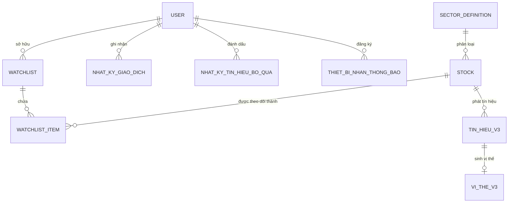

# Mô hình thực thể

> Cập nhật 2026-11-12: chỉ còn **13 bảng** (`ApplicationDbContextModelSnapshot.cs`). 26 bảng V1 đã xoá bằng migration `20261112064612_RemoveV1Tables`; danh sách bảng cũ xem [`features/v1-archive/`](./features/v1-archive/README.md).

## Sơ đồ quan hệ thực thể

### USER

Người dùng đăng nhập vào JUICE (đã đăng ký hoặc khách).

| Attribute | Description | Data Type | Length/Precision | Validation Rules |
|-----------|-------------|-----------|------------------|------------------|
| id | Định danh duy nhất | Guid | 36 | Primary Key |
| email | Email đăng nhập | String | 256 | Not Null, Unique, Format: Email |
| password_hash | Bí mật xác thực đã lưu | String | 512 | Not Null |
| display_name | Tên hiển thị trong ứng dụng | String | 128 | Not Null |
| is_guest | Có phải danh tính khách hay không | Boolean | 1 | Not Null |
| created_at | Thời điểm tạo tài khoản | DateTime | 23,3 | Not Null |

### STOCK

Cổ phiếu niêm yết trong vũ trụ đầu tư. Nguồn nến ngày dùng chung cho Job 1, Job 2 và V3.

| Attribute | Description | Data Type | Length/Precision | Validation Rules |
|-----------|-------------|-----------|------------------|------------------|
| symbol | Mã giao dịch trên sàn | String | 16 | Primary Key, Not Null |
| name | Tên công ty hoặc công cụ | String | 128 | Not Null |
| sector | Nhãn ngành | String | 64 | Not Null |
| sector_locked | Ngành bị khóa thủ công | Boolean | 1 | Not Null |
| history_json | Nến ngày đã tuần tự hóa | String | 0 | Not Null |
| last_change_percent | Biến động phần trăm phiên gần nhất | Decimal | 18,2 | Not Null |
| last_close | Close của nến cuối (denormalize để tính breadth) | Decimal | 18,2 | Not Null |
| last_volume | Volume của nến cuối (denormalize) | Long | 19 | Not Null |
| is_active | Có nằm trong vũ trụ đang hoạt động | Boolean | 1 | Not Null |
| exchange | Sàn niêm yết | String | 16 | Not Null |
| avg_volume_30d | Khối lượng trung bình khoảng 30 phiên | Decimal | 18,2 | Not Null |
| trading_restricted | Cờ hạn chế giao dịch | Boolean | 1 | Not Null |
| trading_status | Ghi chú hạn chế (đọc được) | String | 128 | Optional |
| first_trade_date | Ngày giao dịch đầu tiên đã biết | Date | 10 | Optional |
| universe_updated_at | Lần làm mới vũ trụ gần nhất | DateTime | 23,3 | Optional |

### MARKET_INDEX

Chỉ số tham chiếu dùng cho bối cảnh thị trường (thường là VNINDEX).

| Attribute | Description | Data Type | Length/Precision | Validation Rules |
|-----------|-------------|-----------|------------------|------------------|
| symbol | Mã chỉ số | String | 32 | Primary Key, Not Null |
| price | Mức chỉ số mới nhất | Decimal | 18,2 | Not Null |
| change_percent | Biến động phần trăm trong phiên | Decimal | 18,2 | Not Null |
| score | Điểm thị trường suy ra: clamp(50 + change% × 10, 0, 100) | Integer | 10 | Not Null |
| trend | Xu hướng mã hóa theo change% (> 0,5 tăng · < −0,5 giảm · còn lại đi ngang) | Integer | 10 | Not Null |
| updated_at | Thời điểm cập nhật gần nhất | DateTime | 23,3 | Not Null |
| history_json | Thanh chỉ số đã tuần tự hóa | String | 0 | Not Null |

> `EfMarketDataWriter` ghi VNINDEX với O = H = L = C = giá chỉ số (PH-31) — đừng dùng nến này cho luật hình nến.

### SECTOR_DEFINITION

Mục danh mục tên ngành dùng cho xếp hạng và bộ lọc.

| Attribute | Description | Data Type | Length/Precision | Validation Rules |
|-----------|-------------|-----------|------------------|------------------|
| id | Định danh duy nhất | Integer | 10 | Primary Key, Sequence |
| name | Tên ngành hiển thị | String | 64 | Not Null, Unique |
| sort_order | Thứ tự hiển thị | Integer | 10 | Not Null |
| is_active | Ngành có đang được dùng | Boolean | 1 | Not Null |

### WATCHLIST

Danh sách theo dõi của một người dùng — mặc định, ngành (tự động) hoặc tùy chỉnh.

| Attribute | Description | Data Type | Length/Precision | Validation Rules |
|-----------|-------------|-----------|------------------|------------------|
| id | Định danh duy nhất | Integer | 10 | Primary Key, Not Null |
| user_id | Người dùng sở hữu | Guid | 36 | Not Null, Foreign Key (USER.id), Cascade delete |
| name | Tên hiển thị | String | 128 | Not Null |
| la_danh_sach_nganh | Danh sách ngành tự động (items query động) | Boolean | 1 | Not Null |
| ma_nganh | Tên ngành nếu là danh sách ngành | String | 64 | Optional, Unique (user_id, ma_nganh) khi NOT NULL |
| thu_tu | Thứ tự hiển thị (0 = mặc định, 1..N = ngành, sau đó tùy chỉnh) | Integer | 10 | Not Null |
| la_mac_dinh | Danh sách mặc định của user (không xóa được) | Boolean | 1 | Not Null, Unique (user_id) khi = 1 |
| created_at | Thời điểm tạo | DateTime | 23,3 | Not Null |

> **Lazy seeding:** lần `GET /api/v1/watchlists` đầu tiên của mỗi user tạo danh sách mặc định + các danh sách ngành theo `SectorCatalog.DefaultSectors`. Danh sách mặc định và danh sách ngành không thể xóa; danh sách ngành không thể đổi tên.

### WATCHLIST_ITEM

Mã trong một danh sách theo dõi — duy nhất theo (watchlist_id, symbol).

| Attribute | Description | Data Type | Length/Precision | Validation Rules |
|-----------|-------------|-----------|------------------|------------------|
| id | Định danh duy nhất | Long | 19 | Primary Key, Not Null |
| watchlist_id | Danh sách chứa mã này | Integer | 10 | Not Null, Foreign Key (WATCHLIST.id), Cascade delete |
| symbol | Mã được theo dõi | String | 16 | Not Null, Foreign Key (STOCK.symbol), Unique (watchlist_id, symbol) |
| added_at | Thời điểm thêm | DateTime | 23,3 | Not Null |

> **Danh sách ngành không dùng bảng này:** khi `la_danh_sach_nganh = true`, items query động theo `ma_nganh` từ các mã active của ngành.
>
> **API list (không persist):** `WatchlistItemDto` chỉ mang `Symbol`, `Name`, `Sector`, `ChangePercent`, `SectorLocked`, `TrangThaiV3` (huy hiệu V3 đọc từ `TinHieuV3`/`ViTheV3`). Không còn cột điểm V1.

### JOB_RUN_STATUS

Lần chạy cuối của mỗi pipeline job (1 dòng/job, upsert) — ghi bởi `JobStatusService`.

| Attribute | Description | Data Type | Length/Precision | Validation Rules |
|-----------|-------------|-----------|------------------|------------------|
| job_id | Mã job | String | 64 | Primary Key, Not Null |
| status | Kết quả lần chạy cuối | String | 16 | Not Null, Enum: success \| failed |
| triggered_by | Nguồn kích hoạt | String | 16 | Optional, Enum: schedule \| manual |
| last_started_at | Thời điểm bắt đầu gần nhất | DateTime | 23,3 | Optional |
| last_finished_at | Thời điểm kết thúc gần nhất | DateTime | 23,3 | Optional |
| last_duration_ms | Thời lượng lần chạy gần nhất (ms) | Long | 19 | Optional |
| summary | Tóm tắt kết quả | String | 512 | Optional |
| error | Thông báo lỗi | String | 1024 | Optional |

### TIN_HIEU_V3

Một lần một kịch bản V3 báo trên một mã tại một phiên. Chụp snapshot đủ để giải thích.

| Attribute | Description | Data Type | Length/Precision | Validation Rules |
|-----------|-------------|-----------|------------------|------------------|
| id | Định danh duy nhất | Long | 19 | Primary Key |
| symbol | Mã | String | 16 | Not Null |
| loai | Kịch bản | Integer | 10 | Not Null, Enum: KB1 · KB2 · KB4 · N1 · N3 |
| ngay_tin_hieu | Phiên tín hiệu T (nến cuối dùng để chấm) | Date | 10 | Not Null |
| gia_tin_hieu | Giá tham chiếu/khớp tại phiên tín hiệu (nghìn đồng) | Decimal | 18,2 | Not Null |
| hang | Hạng trong kịch bản (1 = tốt nhất) | Integer | 10 | Not Null |
| gia_tri_xep_hang | Thước xếp hạng (RS126/RSI14/RET20/SECR20/RS63) | Decimal | 18,2 | Not Null |
| mua_mo_cua_phien_sau | true = ATO phiên sau (KB1/KB2); false = ATC phiên tín hiệu | Boolean | 1 | Not Null |
| trang_thai | Vòng đời tín hiệu | Integer | 10 | Not Null, Enum: DaBao · BiCatDanhMuc · DaVaoLenh · BiHuy |
| snapshot_json | Chỉ báo quyết định (TV20/BREADTH50/độ lệch MA50/FLOOR20/LEFT/TDM) | String | 0 | Optional |
| gia_vao / gia_thoat | Mirror từ vị thế khi khớp | Decimal | 18,2 | Optional |
| phan_tram_loi_nhuan | Lãi ròng % mirror từ vị thế khi đóng | Decimal | 18,2 | Optional |
| ket_qua | Thang · Thua · HoaVon (null khi đang giữ) | String | 16 | Optional |
| created_at / updated_at | Thời điểm tạo / cập nhật | DateTime | 23,3 | Not Null |

### VI_THE_V3

Lệnh đang giữ hoặc đã đóng của V3 (mỗi lệnh từ đúng một tín hiệu).

| Attribute | Description | Data Type | Length/Precision | Validation Rules |
|-----------|-------------|-----------|------------------|------------------|
| id | Định danh duy nhất | Long | 19 | Primary Key |
| tin_hieu_v3_id | Tín hiệu sinh ra lệnh | Long | 19 | Not Null, Foreign Key (TIN_HIEU_V3.id) |
| symbol | Mã | String | 16 | Not Null |
| loai | Kịch bản | Integer | 10 | Not Null |
| ngay_tin_hieu | Phiên tín hiệu | Date | 10 | Not Null |
| trang_thai | Trạng thái vị thế | Integer | 10 | Not Null, Enum: DanhDau · ChoMua · DangGiu · DaThoat · BiHuy |
| ngay_vao / gia_vao | Phiên khớp mua / giá vào (nghìn đồng) | Date · Decimal | 10 · 18,2 | Optional |
| khoi_luong / gia_tri_lenh | Khối lượng / giá trị lệnh | Decimal | 18,2 | Optional |
| so_phien_da_gi | Số phiên đã giữ tính từ phiên tín hiệu | Integer | 10 | Not Null |
| nguong_cham_ma | Ngưỡng bán hiện hành (TB n−1 giá đóng cửa, hoặc giá vào × 1,15 khi hoảng loạn sâu) | Decimal | 18,2 | Optional |
| la_hoang_loan_sau | Chốt một lần lúc tạo vị thế: BREADTH50 < 0,15 | Boolean | 1 | Not Null |
| gia_tham_chieu | Đóng cửa phiên liền trước — kiểm tra trần/sàn mà không nạp lịch sử | Decimal | 18,2 | Optional |
| exchange | Sàn của mã (biên độ trần/sàn) | String | 16 | Optional |
| ngay_thoat / gia_thoat | Phiên thoát / giá thoát | Date · Decimal | 10 · 18,2 | Optional |
| ly_do_thoat | ChamMA · ChotLoiHoangLoan · HetHanATC · AtoTheoLich | String | 32 | Optional |
| phan_tram_loi_nhuan | Lãi ròng % (đã trừ phí) khi đóng | Decimal | 18,2 | Optional |
| ket_qua | Thang · Thua · HoaVon | String | 16 | Optional |
| mfe / mae | Lãi cao nhất / lỗ sâu nhất | Decimal | 18,2 | Optional |
| da_ban_tin_thoat | Đã bắn tin bán (chống spam) | Boolean | 1 | Not Null |
| doi_chieu_mua / doi_chieu_ban | Phần mua/bán đã lấy theo lệnh thật (spec 014) | Boolean | 1 | Not Null |
| doi_chieu_luc | Lần đối chiếu nhật ký gần nhất (UTC) | DateTime | 23,3 | Optional |
| created_at / updated_at | Thời điểm tạo / cập nhật | DateTime | 23,3 | Not Null |

### CHI_SO_NGAY_V3

Chỉ báo thị trường tính một lần/ngày, mọi kịch bản dùng chung.

| Attribute | Description | Data Type | Length/Precision | Validation Rules |
|-----------|-------------|-----------|------------------|------------------|
| id | Định danh duy nhất | Long | 19 | Primary Key |
| ngay | Phiên | Date | 10 | Not Null |
| so_ma_uni | Số mã thuộc UNI | Integer | 10 | Not Null |
| breadth50 | Tỉ lệ mã trên MA50 | Decimal | 18,2 | Not Null |
| chi_so | Điểm chỉ số phiên | Decimal | 18,2 | Not Null |
| chi_so_ma50 | MA50 của chỉ số | Decimal | 18,2 | Not Null |
| chi_so_do_lech_ma50_phan_tram | Độ lệch chỉ số so MA50 (%) | Decimal | 18,2 | Not Null |
| left | Số phiên còn lại tới đỉnh (LEFT) | Integer | 10 | Not Null |
| tdm | Số mã TDM | Integer | 10 | Not Null |
| danh_sach_uni | Danh sách mã UNI phiên này (dấu phẩy) — tập mã nhịp sau nạp | String | 0 | Optional |
| created_at | Thời điểm tạo | DateTime | 23,3 | Not Null |

### NHAT_KY_GIAO_DICH

Lệnh thật khớp lệnh của user (nhật ký giao dịch, spec 010).

| Attribute | Description | Data Type | Length/Precision | Validation Rules |
|-----------|-------------|-----------|------------------|------------------|
| id | Định danh duy nhất | Guid | 36 | Primary Key |
| user_id | Người dùng sở hữu | Guid | 36 | Not Null, Foreign Key (USER.id) |
| ma_chung_khoan | Mã | String | 16 | Not Null |
| chieu | Chiều lệnh | String | 16 | Not Null, Enum: Mua · Ban · DieuChinh |
| thoi_diem_khop | Thời điểm khớp | DateTime | 23,3 | Not Null |
| gia_khop / khoi_luong | Giá khớp / khối lượng | Decimal | 18,2 | Not Null |
| phi | Phí giao dịch | Decimal | 18,2 | Optional |
| nguon_tin_hieu / ma_tin_hieu | Nguồn và mã tín hiệu V3 gắn vào lệnh | String | 64 | Optional |
| gia_tin_hieu_chup | Giá tín hiệu lúc ghi | Decimal | 18,2 | Optional |
| ghi_chu / ly_do | Ghi chú / lý do | String | 512 | Optional |
| klieu_chinh / von_dieu_chinh | Điều chỉnh khối lượng / vốn | Decimal | 18,2 | Optional |
| tao_ngay / cap_nhat_ngay | Thời điểm tạo / cập nhật | DateTime | 23,3 | Not Null · Optional |

### NHAT_KY_TIN_HIEU_BO_QUA

Tín hiệu user đánh dấu "không khớp / bỏ qua".

| Attribute | Description | Data Type | Length/Precision | Validation Rules |
|-----------|-------------|-----------|------------------|------------------|
| id | Định danh duy nhất | Guid | 36 | Primary Key |
| user_id | Người dùng | Guid | 36 | Not Null, Foreign Key (USER.id) |
| nguon | Nguồn tín hiệu | String | 16 | Not Null, Enum: V2 \| VIP |
| ma_tin_hieu | Mã tín hiệu | String | 64 | Not Null |
| symbol | Mã cổ phiếu | String | 16 | Not Null |
| ly_do | Lý do bỏ qua | String | 512 | Optional |
| bo_qua_ngay | Thời điểm đánh dấu | DateTime | 23,3 | Not Null |

### THIET_BI_NHAN_THONG_BAO

Thiết bị đã đăng ký nhận push (spec 013).

| Attribute | Description | Data Type | Length/Precision | Validation Rules |
|-----------|-------------|-----------|------------------|------------------|
| id | Định danh duy nhất | Long | 19 | Primary Key |
| user_id | Người dùng sở hữu | Guid | 36 | Not Null |
| token | FCM token | String | 512 | Not Null |
| nen_tang | Nền tảng | String | 16 | Not Null, mặc định android |
| ngay_dang_ky | Thời điểm đăng ký | DateTime | 23,3 | Not Null |
| lan_cap_nhat_gan_nhat | Lần cập nhật gần nhất | DateTime | 23,3 | Not Null |

---

> **Bảng còn trên DB nhưng ngoài model:** `KetQuaKichBan` (V2, ngừng ghi từ spec 012). Không có entity, không có migration xoá.
