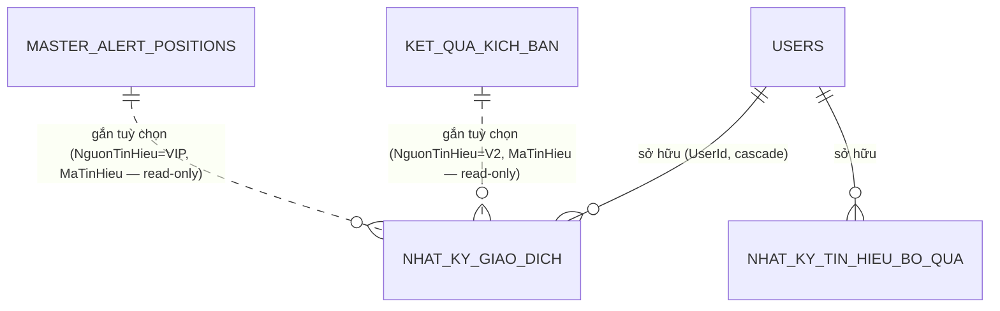

# Phase 1 Data Model: Nhật ký giao dịch thật

**Branch**: `010-trade-journal` | **Date**: 2026-10-21
**Nguồn quyết định**: [plan.md](./plan.md) (Design Decisions 1–7), [research.md](./research.md) (D1–D7). Toàn bộ là **bảng mới**; không sửa bảng/cột/API hiện có (FR-007, ràng buộc "chỉ thêm mới").

## ER tổng quan



Đường nét đứt = **tham chiếu mềm, không FK constraint**: tín hiệu gốc có thể bị xoá/huỷ mà lệnh vẫn phải giữ (spec Edge Cases) — vì đã chụp `GiaTinHieuChup` nên không cần JOIN cưỡng chế. (Đề xuất — xem plan Q2 về nguồn VIP.)

## Bảng 1 — `NhatKyGiaoDich` (lệnh thật)

1 dòng = 1 lệnh nhập tay (Mua / Bán / Điều chỉnh).

| Cột | Kiểu | Bắt buộc | Mô tả |
|---|---|---|---|
| `Id` | int PK autoincrement | ✓ | Khoá nội bộ. |
| `UserId` | Guid FK→`Users`, cascade delete | ✓ | Chủ nhật ký (N6). Lấy từ `ICurrentUserService`, **không** nhận từ body. |
| `Symbol` | string(16), uppercase | ✓ | Mã CK. Chuẩn độ dài theo mọi bảng tickers (`HasMaxLength(16)`). |
| `LoaiLenh` | string(16): `Mua` \| `Ban` \| `DieuChinh` | ✓ | Nhãn tiếng Việt, nhất quán convention `LyDoThoatHet` trong `KetQuaKichBan`. |
| `ThoiDiemKhop` | DateTime (UTC) | ✓ | Thời điểm khớp; UI hiển thị giờ VN (plan Q6). |
| `GiaKhop` | decimal(18,2), > 0 | ✓ với Mua/Ban, null với DieuChinh | Giá khớp thật. |
| `KhoiLuong` | decimal(18,4), > 0 | ✓ với Mua/Ban | KL thật; decimal để nhập lô lẻ (le10 không cưỡng chế — research D5). |
| `Phi` | decimal(18,2), ≥ 0, nullable | — | **Tiền phí/thuế thực** cho lệnh (VND). Null → server dùng % config `RealizedPnl` (mua 0.15 / bán 0.25 + thuế 0.1). Có giá trị → server quy `% hiệu dụng = Phi / (GiaKhop × KhoiLuong) × 100` khi tính (FR-005). |
| `NguonTinHieu` | string(8): `V2` \| `VIP`, nullable | — | Tín hiệu gắn kèm (N1). Null = lệnh tự do. |
| `MaTinHieu` | string(32), nullable | — | V2 = `KetQuaKichBan.Id` (int chuỗi hoá); VIP = `MasterAlertPositions.Id`. Pair bắt buộc theo `NguonTinHieu`. |
| `GiaTinHieuChup` | decimal(18,2), nullable | — khi có tín hiệu | Ảnh chụp giá tín hiệu **lúc gắn** theo **chiều + thứ tự lệnh trong cùng chu kỳ (N8)**, server tự chụp, không đọc lại nguồn sau đó. V2: mua1 = `GiaVaoThucTe ?? KeHoach.GiaVaoLenhMin`, mua2 = `GiaMuaDiem2ThucTe`; bán đầu = `GiaBanNua` (không có thì `GiaThoatHet`), bán sau = `GiaThoatHet`. VIP: mua1 = `EntryPrice` (mua2 không có cột → null), bán theo `PositionSellLegs` (`BanNua`/`BanHet`.`SellPrice`). Tín hiệu chưa có giá ở bậc tương ứng → null, lệch để trống. Tín hiệu bị xoá → giữ ảnh chụp; thêm/sửa/xoá lệnh làm đổi thứ tự → chụp lại các lệnh bị dịch bậc. |
| `LyDo` | string(64), nullable | — | Lý do vào/ra — chọn từ danh sách constants mới `NhatKyHangSo.LyDos` (Breakout, KB, trượt SL…; tiếng Việt). |
| `GhiChu` | string(512), nullable | ✓ với DieuChinh | Ghi chú tự do; **bắt buộc** với lệnh điều chỉnh (N7). |
| `KLieuChinh` | decimal(18,4), nullable | — chỉ DieuChinh | Lượng cộng/trừ (+,−) vào vị thế (N7 — ví dụ nhận cổ tức bằng cp: +KL). |
| `VonDieuChinh` | decimal(18,4)/share, nullable | — chỉ DieuChinh | Cộng/trừ vào **giá vốn bình quân** tại thời điểm (N7 — ví dụ quyền mua trả tiền: +value/cp). |
| `CreatedAt` / `UpdatedAt` | DateTime (UTC) | ✓ | Audit. |

**Validation (tầng service — implement research D6)**:
1. Mua/Ban: `GiaKhop > 0`, `KhoiLuong > 0` (thiếu → 400).
2. Ban: `Σ KL mở tại Symbol (xét theo ThoiDiemKhop + các lệnh DieuChinh)` ≥ `KhoiLuong`, và phải > 0 (bán khi chưa có mua) — vi phạm → **422** (đề xuất cứng, plan Q7).
3. DieuChinh: `KLieuChinh` hoặc `VonDieuChinh` phải khác 0; `KLieuChinh` không làm tồn kho âm; `GhiChu` bắt buộc.
4. Cặp `NguonTinHieu`/`MaTinHieu`/`GiaTinHieuChup` phải đủ bộ hoặc đủ trống; server **không** tin `GiaTinHieuChup` do client gửi — server đọc giá từ bảng tín hiệu gốc tại thời điểm tạo rồi tự chụp (chống client gian lệch).
5. Không cho `ThoiDiemKhop` ở tương lai.

**Indexes**: `IX (UserId, ThoiDiemKhop)` (danh sách + recompute), `IX (UserId, Symbol)` (vị thế), `IX (NguonTinHieu, MaTinHieu)` (lệch theo tín hiệu, tỷ lệ khớp). Pattern theo `ApplicationDbContext.cs:109-120, 469`.

## Bảng 2 — `NhatKyTinHieuBoQua` (tín hiệu bỏ qua / không khớp)

1 dòng = 1 tín hiệu được đánh dấu "bỏ qua" (FR-003, spec AC3 US2). Bảng tách để không tạo "lệnh ma" (plan Q3).

| Cột | Kiểu | Bắt buộc | Mô tả |
|---|---|---|---|
| `Id` | int PK | ✓ | |
| `UserId` | Guid FK→`Users`, cascade | ✓ | |
| `NguonTinHieu` | string(8) `V2`/`VIP` | ✓ | |
| `MaTinHieu` | string(32) | ✓ | Như bảng 1. |
| `Symbol` | string(16) | ✓ | Chụp để hiển thị, không cần JOIN. |
| `LyDoBoQua` | string(512), nullable | — | VD: "nhảy quá xa", "không đủ tiền". |
| `NgayBoQua` | DateTime (UTC) | ✓ | |

Unique `IX (UserId, NguonTinHieu, MaTinHieu)` — một tín hiệu chỉ bỏ qua một lần. XOÁ dòng này khi user gán lệnh thật cho cùng tín hiệu (bỏ qua → khớp là hợp lệ, spec AC3 "đánh dấu bỏ qua / không khớp" là trạng thái đảo được — đề xuất, xem note cuối).

## Bảng 3 — (Không có) vị thế

`Vị Thế Thật` là **projection on-the-fly**, không bảng: gộp `NhatKyGiaoDich` theo `Symbol` của một user, xử lý theo `ThoiDiemKhop`:

```
KL mở      = Σ KL(Mua) − Σ KL(Ban) + Σ KLieuChinh
Giá vốn BQ = [ Σ (GiaKhop_i × (1 + phi_i%) × KL_i) − Σ tiền đã bán theo giá vốn
              + Σ VonDieuChinh × KL mở sau điều chỉnh ] / KL mở
```

(công thức chuẩn hoá đầy đủ ở research D5; phần giảm giá vốn khi bán nửa theo chuẩn bình quân: bán ra không đổi giá vốn phần còn lại — giá vốn BQ giữ nguyên sau nhịp bán, chỉ KL giảm.)

Lý do không bảng hoá: sửa/xoá lệnh tự recompute (AC3 US1 không cần code bù trừ), tránh drift giữa 2 nguồn sự thật.

US3: projection `/vi-the` gồm cả vị thế **đã đóng** (`daDong`, `ngayDong` = ngày nhịp bán cuối) + lãi/lỗ đã thực hiện từng nhịp. Vì giá vốn BQ đã gồm phí mua, FeeProfile mỗi nhịp chỉ `(0, phí bán + thuế bán, 0)` — tránh cộng trùng phí mua (contracts §4).

## Thang đo kết quả (dùng lại `RealizedPnlMath` — N5 xác nhận, chờ duyệt)

| Khái niệm | Công thức | Hàm tái sử dụng |
|---|---|---|
| P&L 1 nhịp bán (%, trên giá vốn) | `R_i` sau phí mua+phí/thuế bán | `RealizedPnlMath.NetLegReturnPercent` (`RealizedPnlMath.cs:37-45`) |
| P&L vị thế đã đóng | trọng số theo KL thực bán | `RealizedPnlMath.Compute(...).ReturnOnDeployedPercent` (`:51-93`) |
| Thắng/Thua/Ngang tài khoản | ngưỡng `RealizedPnl:WinThresholdPercent` (= 0) | `RealizedPnlMath.Classify` (`:99-108`) → map Good→"Thắng", Flat→"Ngang", Failed→"Thua" theo nhãn `KetQuaDoLuong` hiện có (chỉ **nhãn**, không đụng bảng V2) |
| Lệch so tín hiệu | `GiaKhop − GiaTinHieuChup` (và %) | mới, service |
| Lệch theo tín hiệu (nhiều lệnh) | `bq(GiaKhop các lệnh cùng tín hiệu, CÙNG CHIỀU và CÙNG mức giá chụp N8) − GiaTinHieuChup` | mới, service |
| Tỷ lệ khớp | `tín hiệu có lệnh / (có lệnh + bỏ qua)` trong kỳ | mới, service |

Số tiền tuyệt đối: `LoiNhuanRongVND = Σ[KhoiLuong_i × (netProceeds_i − buyCost_i)]` — tính trong service, cùng FE với math (làm tròn 2 chữ số, InvariantCulture theo convention `FeeProfile.Key`).

## Quan hệ với dữ liệu tín hiệu (chỉ đọc — FR-007)

| Nguồn | Bảng | Cột đọc | Dùng ở |
|---|---|---|---|
| V2 | `KetQuaKichBan` (`ApplicationDbContext.cs:485-515`) | Id, Symbol, LoaiKichBan, TrangThai=DaKichHoat, NgayDanhGia, GiaVaoThucTe, KeHoachGiaoDichJson, KetQuaDoLuong | Picker tín hiệu, cột "kết quả tín hiệu" cạnh "kết quả thật" (US3 AC3) |
| V1 VIP | `MasterAlertPositions` (`:322-345`) + `PositionSellLegs` (`:347-362`) | Id, Symbol, EntryDate, EntryPrice, IsClosed, RealizedReturnOnDeployedPercent; SellLegs: Signal/SellPrice/SellDate | Picker VIP, kết quả tín hiệu bán song song |

**Không** ghi, không migration, không đổi DTO của hai nguồn này. Endpoint picker là route **mới** dưới `/api/v1/nhat-ky/tin-hieu/*` (xem contracts; VIP theo plan Q2 — API cũ `/performance/alert-history` đã bị xoá ở `183adb5`).

## Ghi chú thiết kế chưa chốt (liên kết plan Q1–Q7)

- Đặt tên cột `KLieuChinh`/`VonDieuChinh`/DieuChinh: theo convention pha trộn Việt/Anh hiện có (cột `GiaVaoThucTe`, `LyDoThoatHet` đứng cạnh `Symbol`, `EntryPrice`); tên chính thức có thể đổi khi tasks.
- "Bỏ qua" có đảo được sang "khớp" không (XOÁ dòng bo qua khi gán lệnh) — đề xuất: có; chấp nhận nếu chủ sản phẩm muốn lock cứng.
- Bảng `TradeJournalEntries` cũ: để nguyên, không trong model này (plan Q1).
